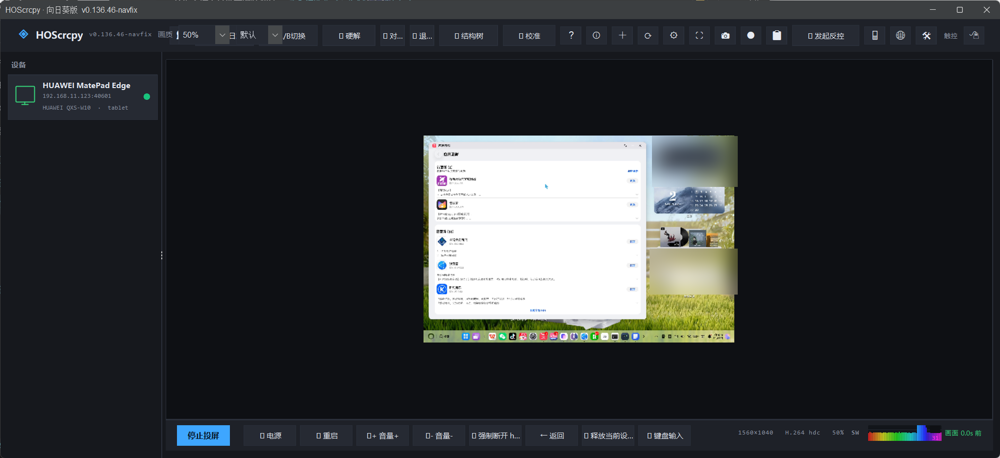
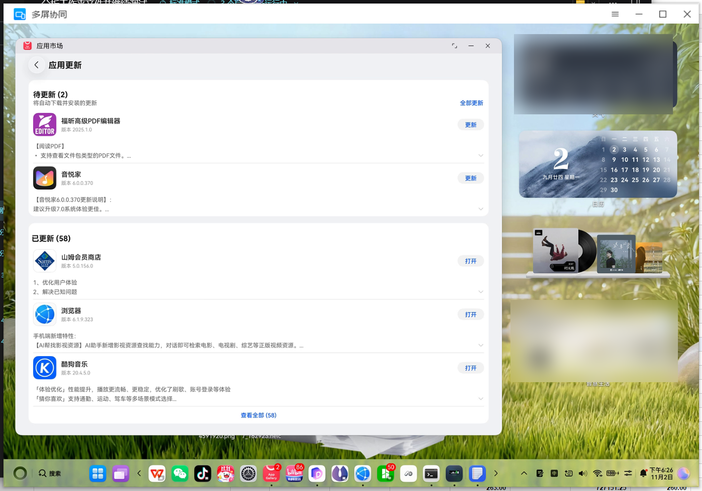
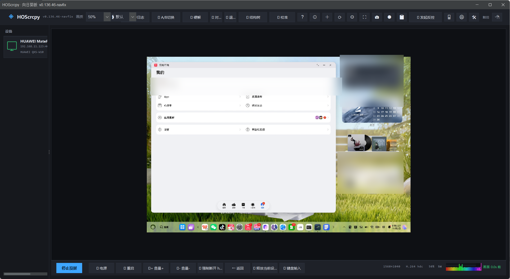
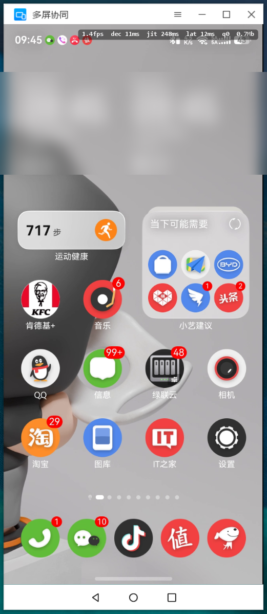

# HOScrcpy-Sun

> 本项目是 **[HOScrcpy](https://gitcode.com/OpenHarmonyToolkitsPlaza/HOScrcpy)（鸿蒙远程真机工具，MIT）** 的修改版。
> 上游地址：https://gitcode.com/OpenHarmonyToolkitsPlaza/HOScrcpy
> 原始代码与文档版权归 HOScrcpy 作者所有，遵循 MIT 许可；本仓库的修改部分同样以 MIT 发布。
> 完整许可见 [LICENSE](LICENSE)，来源与版权归属见 [NOTICE](NOTICE)。

在 HOScrcpy 的基础上，重点改造了**纯享窗口外观、输入手感、连接稳定性**。

## 截图

| 主窗口（连接 MatePad Edge） | 纯享窗口 |
|---|---|
|  |  |



> 截图为实际运行画面（HUAWEI MatePad Edge，Windows 11）；账号名、位置/天气、路由信息已模糊处理。
### 窗口细节

| 标题栏 + 三大金刚 | ☰ 菜单 |
|---|---|
|  |  |


## 功能

- **纯享「多屏协同」窗口**：复刻华为 PC 管家多屏协同窗口外观（白色标题栏、图标、☰ — □ ✕、底部三大金刚），支持拖拽、四角等比缩放、位置/大小记忆、可选置顶
- **输入三模式**：触控（无指针）/ 鼠标（指针跟随）/ PC 点击；滚轮、右键=返回、中键=桌面、Home/多任务手势
- **键盘输入**：PC 键盘直接输入到设备当前焦点输入框；Ctrl+V 把本机剪贴板内容输入到设备
- **连接**：LAN / Wi-Fi Direct（P2P）地址自动发现，preferredHost 优先，断线自动重连；退出程序自动 `hdc kill`，也可手动断开
- **画质**：原始 / 50% / 33% 三档，记忆上次选择
- **其它**：性能 HUD（fps/解码/抖动/延迟）、浏览器投屏（WebSocket）、设备工具（应用/文件/熄屏）

## 构建

前置：

- JDK 17、Maven 3.9+
- `hdc`（OpenHarmony command-line-tools）：放到程序目录或加入 `PATH`
- **HOScrcpy SDK**：`hosScrcpy-1.0.18-beta.jar`（闭源，不在本仓库中）。请从上游 HOScrcpy 发布页获取，
  放到 `src/main/resources/libs/` 下

```bash
cd sun
mvn -o -DskipTests package
java -jar target/HOScrcpy.jar
```

Windows 下可直接运行 `b.bat`（自动定位 JDK/Maven、构建、启动）。

## 运行

```bash
# 自动连接上次设备 / 局域网扫描
java -jar target/HOScrcpy.jar

# 指定设备
java -jar target/HOScrcpy.jar -Dsun.connect=192.168.1.100:38387

# 常用调试参数
-Dsun.autostart=true     启动后自动进第一个设备
-Dsun.pure=true          直接以纯享浮窗启动
-Dsun.noauth=true        跳过配对校验（仅调试）
-Dsun.quality=原始|50%|33%
```

## 来源与许可

- 上游项目：**HOScrcpy** — https://gitcode.com/OpenHarmonyToolkitsPlaza/HOScrcpy
- 上游许可：**MIT**（原始 LICENSE 为 MIT 模板）
- 本仓库：基于上游代码修改，修改部分 Copyright (c) 2026 Mangoman2008，同样以 MIT 发布
- 引用/依赖的第三方组件（JavaCPP/FFmpeg、FlatLaf、Jackson、Apache Commons Lang 等）版权归各自作者，许可证见各项目仓库
- `hosScrcpy-*.jar`、`hdc`、设备侧 `uitest`/系统组件为第三方/闭源组件，本仓库不包含，版权归各自作者

本项目与华为无隶属关系，仅供学习与自有设备调试使用。

## 致谢

感谢 **HOScrcpy** 上游项目及 OpenHarmony 社区；感谢 JavaCPP / FFmpeg、FlatLaf、Jackson、Apache Commons Lang 等开源项目。